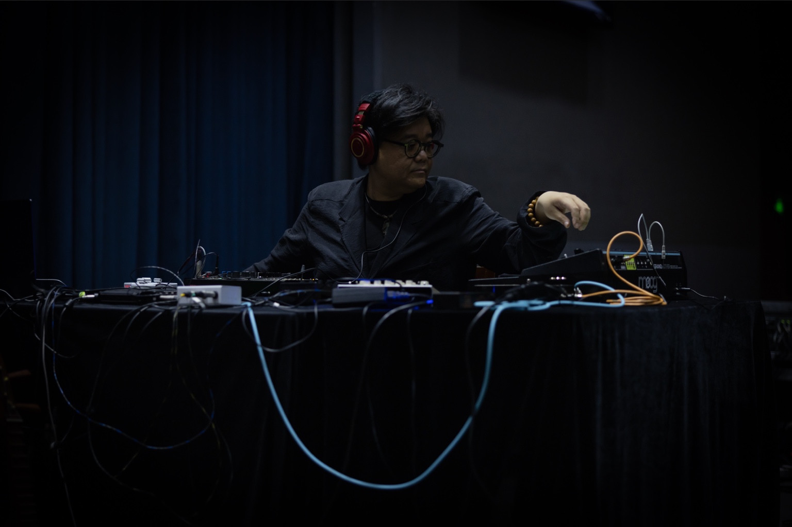

# L+R 7.1.4 LIVE Panner v2.1

[Full English manual (PDF)](https://github.com/bigwanglu/lr-714-panner/releases/download/v2.1.0/LR_714_Panner_v2_1_Manual_EN.pdf) · [Word edition](https://github.com/bigwanglu/lr-714-panner/releases/download/v2.1.0/LR_714_Panner_v2_1_Manual_EN.docx)

[下载中文 PDF 手册](https://github.com/bigwanglu/lr-714-panner/releases/download/v2.1.0/LR_714_Panner_v2_1_Manual_CN.pdf) · [下载 Word 版本](https://github.com/bigwanglu/lr-714-panner/releases/download/v2.1.0/LR_714_Panner_v2_1_Manual_CN.docx)

让声音的移动，成为音乐演奏的一部分。

中文 · [English](README.en.md)

[下载 v2.1 体验版](https://github.com/bigwanglu/lr-714-panner/releases/download/v2.1.0/LR_714_Panner_v2_1_0.zip) · [安装与完整手册](docs/v2.1/guide.zh-CN.md) · [版本记录](docs/versions.md)

L+R 7.1.4 LIVE Panner 是面向 Ableton Live / Max for Live 的空间声像工具，由电子音乐人 L+R 王璐设计，当前免费提供体验。它将单个输入声道分配到 7.1.4 的十二路输出，让左右、前后、高度和运动轨迹成为可直接操作的音乐维度。

v2.1 的核心是独立的 **Motion Editor**：选择轨迹、改变形状、画出路径，再让声音按自己的速度或音乐的节拍运动。从缓慢的 Ambient 环绕，到随乐句往返的空间变化，都可以从同一套界面开始。

## Motion：设计声音如何移动

- **36 种轨迹**：圆形、八字、左右、前后、多边形、花瓣、编织与随机运动。固定形状可编辑节点、调整宽高和整体位置。
- **手绘路径与独立高度**：最多 8 笔 XY 路径，搭配固定、起伏、升降、随机或手绘高度曲线。
- **Free / Sync**：自由模式按每轮秒数运行；同步模式跟随 Live，使用音符、小节、附点与三连音时值。
- **直接演奏与观察**：播放、暂停、反向和起点重置；主界面的 XYZ / 3D 监视显示位置、轨迹和尾迹。手动调整 XYZ 会接管位置并停止 Motion。

原有的 Spread、Focus、LFE、X、Y、Z 六个主控、测试音、十二路电平和六组输出路由继续保留。

## 开始使用

推荐在 macOS、Ableton Live 12 Suite 或具备 Max for Live 的 Live 环境中使用。完整 7.1.4 监听需要至少十二路可用物理输出及相应扬声器系统。

1. 下载上方的 **插件包**并解压。保留整个 `LR_714_Panner_v2_1_0` 文件夹及同目录依赖，不要只复制 `.amxd`。GitHub 自动生成的 “Source code” ZIP 不是安装包。
2. 先降低监听音量，在普通 Audio Track 加载 `LR_714_Panner_v2_1_0.amxd`，将轨道 **Audio To 设为 Sends Only**。
3. 在 Live 的 Output Config 启用 1/2 至 11/12；核对设备 ROUTING 的 TYPE 与 CH 和实际接线。自动选择后也应逐路检查。
4. 从低电平检查输出，确认后关闭 TEST。点击 **MOTION / EDIT**，选一个形状，再设置每轮时长与高度。选择形状会启动 Motion；Sync 还需要 Live 正在播放。
5. 先在工程副本中试用，再加入正式创作或演出。详细通道顺序、参数和排查方法见[中文手册](docs/v2.1/guide.zh-CN.md)。

本设备当前使用首个输入声道，不会自动保留或下混完整立体声输入。它输出离散的 7.1.4 扬声器信号，不提供 Dolby Atmos 编码。真实 Live 音频、保存重开和跨声卡测试尚未全部完成，详见[本版说明](docs/releases/v2.1.md)。

## 文档与反馈

- [English quick start](docs/v2.1/quick-start.en.md)

- [中文完整手册](docs/v2.1/guide.zh-CN.md) / [Full English manual](docs/v2.1/guide.en.md)
- [v2.1 更新与已知限制](docs/releases/v2.1.md)
- [全部版本与 v1.3.1 Public Beta 下载](docs/versions.md)
- [一代 v1.3.1 Public Beta 导览](docs/v1.3.1/README.md)
- [反馈问题与使用想法](https://github.com/bigwanglu/lr-714-panner/issues)

反馈时请注明插件版本、Live / Max / 系统版本、声卡与复现步骤；请勿附带私人音频或完整个人工程。

## 作者寄语

我是电子音乐人 L+R 王璐。这个插件里的很多想法，都来自我长期做全景声混音和现场演出时自己的需要。

我花了几个月去想：我到底想要一个什么样的工具？然后和 AI 一起，把这些想法做了出来。我不会写代码，但现在，我们可以开始用自己的方式，让工具越来越趁手，再慢慢维护、慢慢发展下去。

希望你用它做出心里想要的空间和移动，让自己的音乐更好听。有想法就来聊。大家都玩起来，玩得开心。

[阅读完整作者寄语](docs/author/author-message.zh-CN.md)

L+R 王璐 · L+R SOUNDSYSTEM
