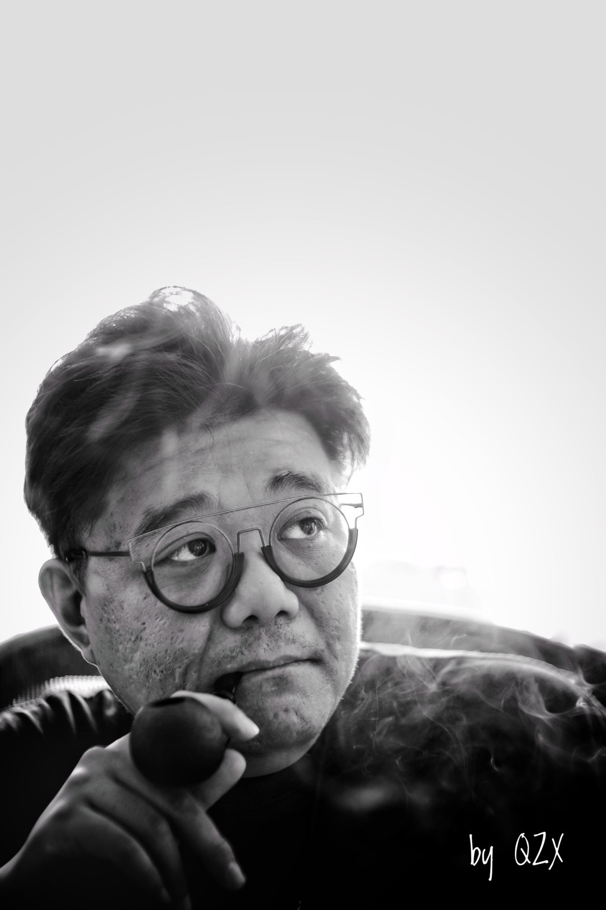

# A note from the author

[English overview](../../README.en.md) · [中文](author-message.zh-CN.md)

Photo credit: by QZX

Hello, I'm L+R, Wang Lu, an electronic musician.

Many of the ideas behind this plugin came from my own needs while mixing spatial audio and performing live over the years. I wanted sound to move more freely through a 7.1.4 space, and I wanted those ideas to give musicians something they could really play with on stage.

I make ambient music, and I'm especially drawn to slow movement. Some ideas might not come up in everyday use, but there will always be people who enjoy experimenting and want to try them. I wanted to leave some room for those ideas too.

I spent a few months thinking about this update: what features did I actually need? Getting AI to write the code took less than two days. I didn't write a single line of it myself. I'm a developer who doesn't know how to code, using AI to help bring my own ideas to life.

So I still want to say: open up your thinking, start playing with AI, and make the tools you want. Those of us who have been making music for years have plenty of ideas, and we know when a tool doesn't quite fit the way we work. Now we can start shaping it in our own way, making it fit a little better, and keeping it maintained and growing over time.

I feel that this era is opening up more and more possibilities for people who have ideas, want to create, and want to try more interesting things. Give it a try.

I hope you enjoy using this plugin, make your music sound better, and create the spaces and movements you hear in your mind. I also welcome you to come and talk: how is it working for you? What ideas do you have? We can explore them together.

The software is still free, and I'll keep updating it. Thank you for your support.

Let's all get into it and have fun.

L+R / Wang Lu
